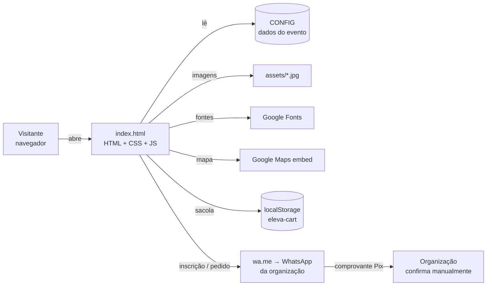
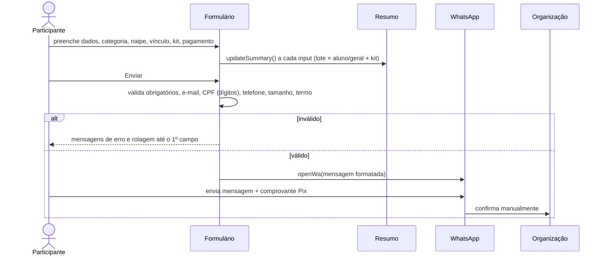
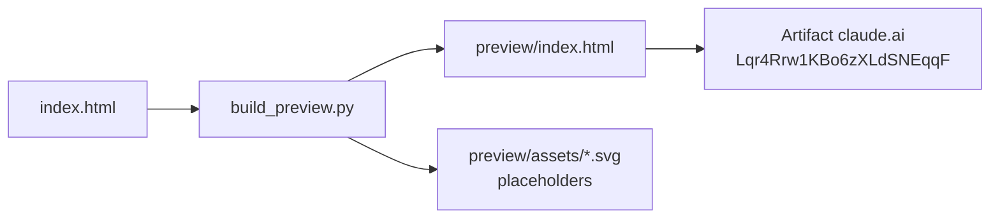

# Arquitetura · Eleva Open Boulder 2026

Última revisão: 28/10/2026

## 1. Visão geral

O site é uma **landing page estática de arquivo único**: HTML, CSS e JavaScript ficam dentro de `index.html`, sem build, sem framework e sem servidor próprio. Os dados do evento ficam num único objeto `CONFIG`, e as "transações" (inscrição e pedido da loja) saem do navegador como mensagens prontas para o WhatsApp da organização.



**Por que assim:** o evento é pontual, a equipe é pequena e o pagamento já é feito por Pix ou na recepção. Um arquivo estático custa zero para hospedar, não tem nada para manter no ar e qualquer pessoa edita preço ou data mexendo só no `CONFIG`.

## 2. Estrutura de arquivos

```
eleva-open-boulder/
├── index.html              site real (com marca)
├── original-backup.html    versão original do cliente, só referência
├── assets/                 10 artes .jpg do Estúdio Avoada
├── tools/build_preview.py  gera a prévia sem marca
├── docs/ARQUITETURA.md     este documento
└── CLAUDE.md               dados do evento e regras do projeto
```

## 3. Camadas dentro do `index.html`

| Camada | Linhas (aprox.) | Responsabilidade |
|---|---|---|
| `<head>` | 1–16 | SEO, Open Graph, favicon, Google Fonts |
| CSS | 17–400 | Tokens em `:root`, componentes, seções, responsivo (1000 / 860 / 600 px), `prefers-reduced-motion` |
| HTML | 405–776 | Topo, 12 seções, rodapé, flutuantes, sacola, lightbox, toast |
| `CONFIG` | 782–822 | **Única fonte de dados**: WhatsApp, data, Pix, kit, lotes, produtos, categorias, naipes, galeria |
| Utilitários | 824–834 | `$`, `$$`, `brl`, `esc`, `store`, `toast`, `waLink`, `openWa` |
| Módulos | 836–1066 | Menu, ticker, contagem, lotes, categorias, loja, galeria, Pix, inscrição, animações, CTA mobile |

### 3.1 Design tokens (CSS)
- **Cores:** `--ink` preto, `--cream`, `--paper`, `--paper2`, `--gold`, `--rust`, `--rust2`, `--olive`, `--blue`.
- **Fontes:** `--display` Alfa Slab One (títulos), `--mono` Courier Prime (rótulos e botões), `--body` DM Sans (texto).
- **Medidas:** `--max` 1180px, `--r` 14px.
- Fundos de seção por classe: `.dark`, `.rust` e o padrão `--paper`.

### 3.2 Seções da página (âncoras)
`#inicio` → `#sobre` → `#categorias` → `#programacao` → `#ingressos` → `#loja` → `#galeria` → `#patrocinadores` → `#inscricao` → `#termo` → `#local` → `#faq`

Seções geradas a partir do `CONFIG` (o HTML só tem o contêiner vazio): categorias (`#cat-grid`), lotes (`#lots`), loja (`#shop-grid`), galeria (`#gallery`), ticker e as opções dos selects de categoria e naipe.

## 4. Modelo de dados (`CONFIG`)

```mermaid
classDiagram
  class CONFIG {
    whatsapp: string  "55 + DDD + número"
    evento: ISO datetime -03:00
    pix: string
    naipes: string[]
    modelos: {nome, tamanhos[]}[]
  }
  class Lote { nome; de; ate; ateHora?; geral|null; aluno|null; geralKit; alunoKit }
  class Produto { id; nome; desc; preco; de?; img; contain?; modelos?; tag?; hot?; cores?: [nome, hex][]; tamanhos?: string[] }
  class Categoria { n; grupo; nome; desc; holds: hex[] }
  class Galeria { src; legenda }
  CONFIG "1" --> "5" Lote : lotes
  CONFIG "1" --> "5" Produto : produtos
  CONFIG "1" --> "7" Categoria : categorias
  CONFIG "1" --> "8" Galeria : galeria
```

Regras:
- `lotes` em ordem cronológica, sem buraco entre `ate` de um e `de` do próximo.
- Produto com `tamanhos` exige escolha de tamanho antes de ir para a sacola.
- Produto com mais de uma `cor` grava a cor na linha da sacola.

## 5. Fluxos principais

### 5.1 Lote vigente
`lotStatus()` compara a hora atual com `de 00:00:00` e `ate` às `ateHora` (padrão `23:59:59`) no fuso `-03:00` e devolve `{ i, aberto }`.
- Dentro de um lote → `{ i, aberto: true }`.
- Entre lotes ou antes do primeiro → o próximo lote com `aberto: false` ("abre em dd/mm").
- Depois do último → `i = -1`, "Vendas encerradas".
- Cada lote tem preço com e sem camiseta. `geral`/`aluno` = `null` indica lote só com camiseta (promocional), e o formulário trava a opção "sem camiseta".

`renderLots()` pinta os cards como `past`, `current` ou `next`, calcula a barra de progresso por tempo e atualiza o selo do topo, o chip "à venda" e o CTA fixo do celular. O seletor "Com camiseta / Sem camiseta" troca entre `geralKit/alunoKit` e `geral/aluno`.

### 5.2 Inscrição



### 5.3 Loja
1. O participante escolhe cor e tamanho no card e clica em Adicionar.
2. A linha entra na sacola com chave `id|cor|tamanho`; item igual soma quantidade.
3. A sacola é salva em `localStorage['eleva-cart']`, com leitura e escrita em try/catch.
4. Em "Finalizar pelo WhatsApp", com o nome preenchido, sai a mensagem com itens, total, retirada e chave Pix.

## 6. Integrações externas

| Serviço | Uso | Se falhar |
|---|---|---|
| WhatsApp (`wa.me`) | Inscrição, pedido, contato, patrocínio | Sem número no `CONFIG`, todos os botões quebram |
| Google Fonts | 3 famílias | Cai para Georgia / monospace / system-ui |
| Google Maps (iframe) | Mapa do local | Fica o fundo cinza; os botões Maps e Waze continuam |
| Clipboard API | Copiar chave Pix | Mostra a chave num toast |

## 7. Prévia sem marca

`tools/build_preview.py` lê o `index.html` e gera uma cópia para aprovação do cliente:



O script troca as artes `.jpg` por SVGs provisórios, tira nome, CNPJ, endereço, Pix e Instagram, troca o mapa por um aviso, faz o WhatsApp abrir uma janela com a mensagem em vez de enviar e coloca a faixa "Prévia para aprovação". No fim, imprime qualquer resto de marca que encontrar. A versão com marca nunca é publicada como Artifact.

## 8. Decisões de arquitetura

| # | Decisão | Motivo | Custo aceito |
|---|---|---|---|
| D1 | Arquivo único, sem build | Edição simples e hospedagem gratuita | Arquivo grande (~1.070 linhas) |
| D2 | `CONFIG` como banco de dados | Preço, data e produto mudam sem tocar no layout | Sem histórico; mudança exige republicar |
| D3 | WhatsApp como checkout | A organização já atende por lá e confirma o Pix manualmente | Nenhum registro centralizado das inscrições |
| D4 | Lote vira pela data | Funciona sem servidor | O texto fala em "ou quando as vagas acabarem", mas o site não conta vagas |
| D5 | Fuso fixo `-03:00` | Brasília não tem horário de verão hoje | Ajustar se voltar o horário de verão |

## 9. Riscos e limitações

- **Sem persistência:** se a mensagem não for enviada, a inscrição se perde. Não há lista oficial além do WhatsApp.
- **Vagas por lote:** a virada por vagas é manual. É preciso editar as datas do `CONFIG` e republicar.
- **LGPD:** CPF e data de nascimento trafegam em texto pelo WhatsApp. Vale avisar a finalidade no formulário e definir quem guarda esses dados e por quanto tempo.
- **Pagamento sem conciliação:** o total enviado é calculado no navegador. A organização precisa conferir o valor do comprovante contra a tabela de lotes.
- **Open Graph:** `og:image` usa caminho relativo. Na hospedagem final, trocar pela URL completa para a prévia do link aparecer no WhatsApp.
- **Patrocinadores:** 3 espaços ainda com "Sua marca aqui".

## 10. Evolução sugerida

| Fase | O que | Ganho |
|---|---|---|
| 1 | Hospedar (Netlify ou similar) com domínio próprio e `og:image` absoluto | Link bonito e compartilhável |
| 2 | Gravar cada inscrição numa tabela (ex.: Supabase) antes de abrir o WhatsApp | Lista oficial, contagem de vagas, exportação |
| 3 | Virada de lote por vagas lendo a contagem da tabela | Cumpre a regra "data ou vagas" |
| 4 | Painel da organização: inscritos, status do pagamento, check-in no dia | Menos trabalho manual |
| 5 | Pix com QR Code dinâmico ou gateway | Conciliação automática |

## 11. Como alterar

| Quero mudar… | Onde |
|---|---|
| Preço ou data de lote | `CONFIG.lotes` |
| Modelos e tamanhos da camiseta | `CONFIG.modelos` |
| Produto da loja | `CONFIG.produtos` |
| Categoria | `CONFIG.categorias` (as opções do formulário saem dela) |
| WhatsApp ou Pix | `CONFIG.whatsapp`, `CONFIG.pix` e o texto fixo do Pix na seção Ingressos e na sacola |
| Programação, FAQ, termo | HTML da seção correspondente |
| Cores e fontes | Tokens em `:root` no topo do `<style>` |

Depois de qualquer mudança: rodar `tools/build_preview.py` e republicar a prévia no mesmo link.
